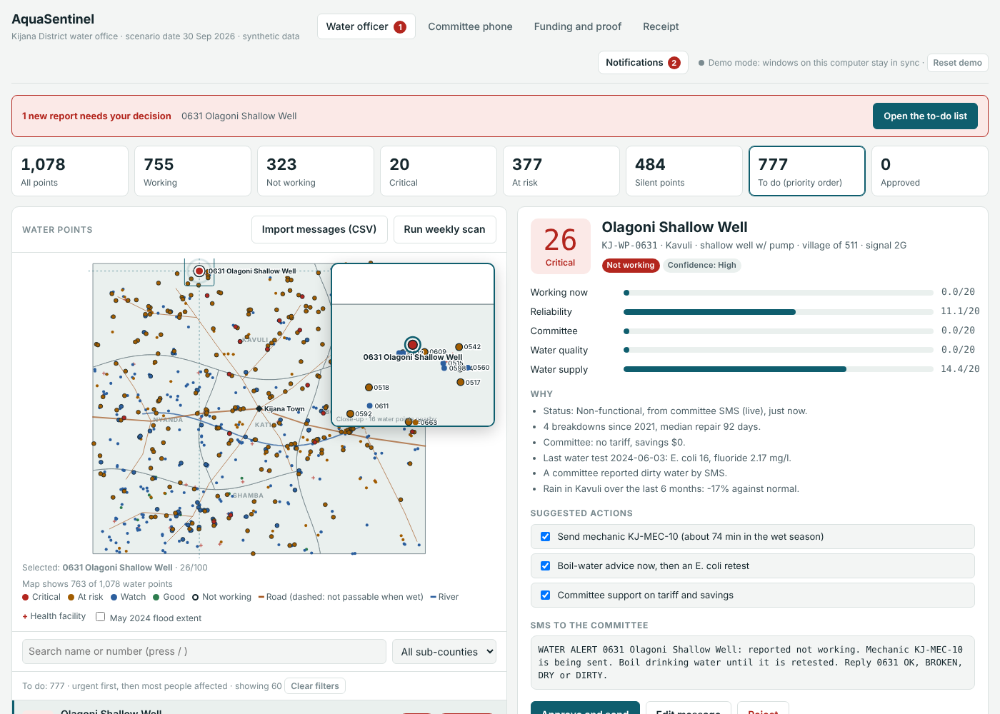
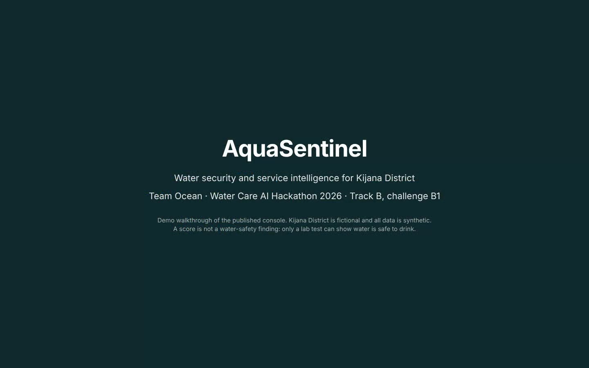
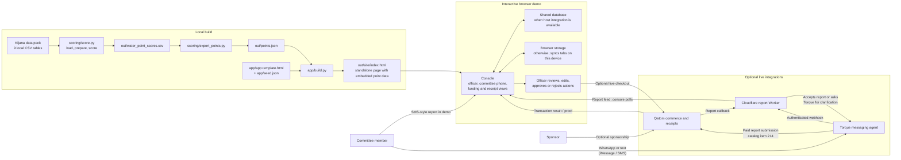
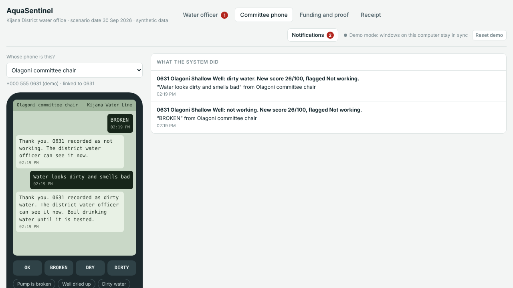

# AquaSentinel

AquaSentinel is Team Ocean's prototype for the **Water Care AI Hackathon 2026**, Track B, challenge B1. It helps a district water officer prioritize rural water points in the fictional Kijana District, gather community reports, and trace demo funding and actions.

The scoring pipeline combines water-point status, repair history, committee records, water-quality tests, and rainfall. The console turns those results into a prioritized work list with reasons and suggested actions. The officer can review, edit, approve, or reject each proposed action; committee reports can update a point's status; and funding or alert actions can produce a receipt through the Agentic Commerce Infra (Qatom).

> **Synthetic scenario and safety:** Kijana District and all data and results are fictional/synthetic. A score or report is not a water-safety determination. Only an appropriate laboratory test can establish whether water is safe to drink.

**Live demo:** [officer view](https://starwaterheaven.github.io/AquaSentinel/) · [committee phone](https://starwaterheaven.github.io/AquaSentinel/#phone) · [funding and proof](https://starwaterheaven.github.io/AquaSentinel/#funding) · [receipt](https://starwaterheaven.github.io/AquaSentinel/#receipt). Republish with `scripts/publish_pages.sh`.



## Try it in 30 seconds

No install needed. Open the officer view and the committee phone **in two windows of the same browser** so they stay in sync.

1. **Officer view:** click the red bar, or the top water point, to see its score in five parts and the reasons in plain words.
2. Press **Approve and send**. Nothing goes out until you do. On the public site the payment is labelled *Simulated*.
3. **Committee phone:** the alert has arrived. Press **BROKEN**, **DRY** or **OK**, or type a message such as `0631 broken`.
4. Back in the officer view, a new urgent report appears and the score has already changed.
5. Open **Funding and proof** to follow a $1 sponsorship from sponsor to committee. **Reset demo** (top right) starts again.

Keyboard: `/` jumps to search, `j` and `k` move down and up the list. Tabs scroll you to the top of their view.

The full five-minute pitch and click path are in [docs/DEMO-SCRIPT.md](docs/DEMO-SCRIPT.md).

**Watch the [2-minute demo video](docs/demo/aquasentinel-demo.mp4)** (captions, no sound):

[](docs/demo/aquasentinel-demo.mp4)

> **Status:** presented on 17 October 2026. The build is frozen at its pitch state. See [`docs/WRAP-UP.md`](docs/WRAP-UP.md) for what is still live, the open decisions, known issues and what we learned.

## At a glance

- **Purpose:** help an officer decide what to inspect or follow up first—not replace field checks or laboratory testing.
- **Scoring:** five dimensions worth 20 points each, for a total of 100, with a separate status flag and confidence label.
- **Community input:** the demo accepts English and common Swahili reports; Torque can submit reports from WhatsApp or connected iMessage/SMS to a Cloudflare Worker.
- **Human control:** officer review comes before an alert or other proposed action is approved.
- **Build:** Python scoring and export scripts generate the data embedded in a browser-based console.
- **Demo payments:** actions can be simulated; Qatom transactions are live only when the required connector and user approval are available.

## System architecture

The diagram separates the **local data-and-build pipeline**, the **interactive demo**, and its **optional live integrations**. The scored snapshot is embedded in the page at build time. Community reports can then update the browser's live point status without rerunning the batch scorer.



### How the pieces fit together

1. **Build a snapshot.** The scorer reads the nine local CSV tables and writes one score record per water point. The exporter turns those records into compact JSON, and the app builder embeds that JSON, the HTML template, and seed demo records in a standalone page.
2. **Review priorities.** The browser app recomputes the displayed score, status, confidence, and suggested actions from each embedded record plus any newer committee report. Its to-do list brings urgent reports, repair follow-ups, and silent points needing inspection to the officer's attention. The officer reviews proposed actions; nothing is approved automatically.
3. **Receive reports.** The Committee phone is an SMS-style interaction inside the demo, not a connection to a cellular network. Separately, Torque can submit reports received on WhatsApp, iMessage, or SMS to the Cloudflare Worker. The console polls the Worker and applies accepted reports to its live state without rebuilding the snapshot.
4. **Record actions.** Demo actions are labelled as simulations unless the viewer has a working Qatom connector. A live checkout may require the user to approve it in TODAQ; the resulting transaction details appear in the funding and receipt views.

The generated page can run locally as a prototype. Shared state depends on the host database integration; without it, the browser uses local storage and can synchronize tabs on the same device. The report Worker and Qatom are separate, optional integrations. The Committee phone view is an SMS-style simulation, not a cellular connection; committees can separately reach Torque on WhatsApp or, through Inkbox, iMessage/SMS. This repository does not provide a production SMS-aggregator integration or an automatic mechanic-payment flow.

## Get started

### Prerequisites

- Python 3
- `pandas` and `numpy`
- The organisers' Kijana District data pack, obtained through the hackathon team
- Node.js (optional; only needed to compare the browser message reader in `scoring/eval_messages.py`)

### Prepare the local data

Copy the permitted CSV files from the Kijana data pack into [`data/`](data/). The pack is not included in this repository. See [`data/README.md`](data/README.md) for details.

The scorer expects these nine CSV files with these exact names:

```text
kijana_water_point_register.csv
kijana_repair_job_cards.csv
kijana_inspection_visits.csv
kijana_verification_survey_2025.csv
kijana_water_committees.csv
kijana_water_quality_results.csv
kijana_settlements.csv
kijana_community_messages.csv
kijana_rainfall_by_subcounty_monthly.csv
```

Do not add the data pack to version control. The `data/` contents (apart from its README) and generated `out/` files are intentionally ignored. Use only the data pack and any supplemental datasets explicitly released to your team; do not use mentor-only or unreleased challenge data.

### Install and build

From the repository root, run:

```bash
python -m pip install pandas numpy
python scoring/score.py
python scoring/export_points.py
python scoring/export_map.py
python app/build.py
```

The scripts run in order:

1. `scoring/score.py` reads the source tables and writes `out/water_point_scores.csv`.
2. `scoring/export_points.py` converts those scores and register details into compact `out/points.json` for the browser app.
3. `app/build.py` combines that point data with the app template and seed records. It writes `out/aquasentinel-console.html` and the standalone site at `out/site/index.html`.

Open `out/site/index.html` in a browser to use the locally built demo. The generated console is self-contained; optional shared-state, report-store, or Qatom integrations depend on their runtime configuration and may not be available in a local build.

To run the backtest as well, use:

```bash
python scoring/backtest.py
```

It scores points using records available before the default 1 January 2024 cutoff and compares the results with later inspection and survey observations. It writes `out/backtest.md` and `out/backtest_scores.csv`. See [`docs/BACKTEST.md`](docs/BACKTEST.md) for methodology and results.

To use a different as-of date, run `python scoring/backtest.py --cutoff YYYY-MM-DD`.

To rebuild and publish the public site, use `scripts/publish_pages.sh` from a Bash environment with the required data pack and push access. The script rebuilds the outputs and force-pushes the published files to the `gh-pages` branch; run it only when you intend to replace the current deployment.

### Troubleshooting

- **A CSV file is missing:** confirm you have the organiser-provided pack and copied all nine required files, with their original filenames, into `data/`.
- **A build step cannot find an output:** run the commands in order from the repository root; the exporter needs the score CSV, and the app builder needs `out/points.json`.
- **The local demo says an integration is unavailable:** the console still works as a standalone demo. Shared state, Torque reports, and live Qatom checkouts require their respective online integrations; otherwise use the local/demo behavior described above.

## Using the demo

The console has four main views:

- **Water officer:** browse and prioritize points, inspect score details and suggested actions, and review or record decisions.
- **Committee phone (`#phone`):** try the SMS-style report flow and see replies in the demo.
- **Funding and proof (`#funding`):** view sponsorship, metering, and funding records.
- **Receipt (`#receipt`):** inspect the receipt view.



In the demo, the officer remains in control of proposed actions. If the Qatom connector is unavailable, transactions are simulated and labelled accordingly. With a live connector, the user must approve a purchase in the TODAQ app or through its approval link before it is charged.

When configured, the console polls the Torque report Worker for new WhatsApp, iMessage, and SMS reports. The Worker has a public read endpoint, while write endpoints require a secret that must not be committed. See [`docs/TORQUE.md`](docs/TORQUE.md) for setup and report formats.

## How prioritization works

Each water point receives five dimension scores, each worth up to 20 points:

| Dimension | Evidence considered |
|---|---|
| **Working now** | Most recent known status from the register, inspections, surveys, job cards, or community reports; older evidence is discounted. |
| **Reliability** | Breakdowns since 2021 and median repair time. |
| **Committee** | Tariff model, savings, recent meeting, and service agreement. Operator-run piped or solar schemes receive a neutral score. |
| **Water quality** | Latest E. coli, fluoride, and nitrate results, with recent dirty-water reports affecting the score. |
| **Water supply** | Recent sub-county rainfall anomaly, with additional weight for shallow wells, and recent dry reports. |

Scores are grouped into **Good** (80–100), **Watch** (60–79), **At risk** (40–59), and **Critical** (below 40). The status flag is a separate priority rule: any point identified as not working is flagged **Not working** and placed first, regardless of its numeric score. Confidence indicates how current the evidence is; **Low** confidence means the point is silent (there is no fresh evidence) and should be considered for inspection.

The score suggests actions such as following up on an open job card, contacting a mechanic, retesting after a water-quality report, inspecting a point, or providing committee support. These are decision-support suggestions, not automatic findings or proof that water is safe.

### Community reports

The Committee phone view's SMS-style reader recognizes statuses such as `OK`, `BROKEN`, `DRY`, and `DIRTY`, as well as common Swahili terms including `sawa`, `mbovu`, `imeharibika`, `hakuna maji`, `kimekauka`, `imekauka`, `chafu`, `kutu`, and `harufu`. A four-digit point code in the message takes precedence. Otherwise, the reader can match an unambiguous registered phone or resolve a point from its ID, village name, and—in ambiguous villages—technology hints. Unresolved reports are sent for clarification rather than guessed.

Torque provides a separate connected messaging path: WhatsApp, or iMessage/SMS through Inkbox. Its Cloudflare Worker accepts a report, replies with confirmation or a clarification request, and exposes reports for the console to poll. Each report records its channel; phone numbers in the public report feed are masked. Setup and report details are in [`docs/TORQUE.md`](docs/TORQUE.md).

## Current scenario results and validation

The 30 September 2026 score v0.4 run covers **1,078 water points**: 755 are marked working and 323 not working. It identifies 20 Critical and 377 At risk points; 484 have Low confidence and are considered silent. These counts describe this synthetic scenario, not real-world conditions.

The backtest evaluates whether the priority signals line up with later field observations. **Precision** is the share of flagged points later found non-functional; **recall** is the share of non-functional points that were flagged.

| Later observation used as ground truth | Points observed | Non-functional (base rate) | Flagged precision | Flagged recall | Silent-list recall |
|---|---:|---:|---:|---:|---:|
| 2024 inspection round | 624 | 130 (21%) | 47% | 72% | 52% |
| August 2025 verification survey | 124 | 35 (28%) | 47% | 49% | 57% |

The silent-list recall column shows why low-confidence points are kept on the inspection list: many non-functional points are not in the flagged group but have no recent evidence either. These results use the supplied scenario data and are not guarantees of future performance. See [`docs/BACKTEST.md`](docs/BACKTEST.md) for the full methodology and tables.

To compare the scoring engine's English/Swahili message reader and the browser app's report parser against the 450 hand-labelled sample messages, run `python scoring/eval_messages.py` after building `out/points.json`. This optional evaluation needs the labelled sample CSV from the data pack; Node.js is needed for the browser-app comparison. It prints the comparison table in the terminal.

## Payments and indicative costs

The demo uses Qatom catalog items for example commerce flows:

| Item | Demo action | Scenario price |
|---|---|---:|
| 212 | Sponsor a district or water point | $1 |
| 213 | Officer-approved water alert | $0.02 |
| 214 | Submit a committee report through Torque | $0.001 |

The app also uses $0.001 as an indicative metering price per scoring or agent call. Prices are scenario values, not a production tariff. The scenario estimates overall monitoring at approximately $3.46–$7.26 per point per year; see [`llms.txt`](llms.txt) for the stated assumptions. The whole district comes to about $3,600–$7,600 a year, inside the district's own monitoring budget line ($7,300 budgeted, $5,200 released in 2025/26). Repairs are paid by sponsors (NGOs, councils, companies, the public) into the district escrow or one water point's escrow, topped up by committee tariffs. A proposed mechanic payment on confirmed repair is a future concept, not a live feature.

## Limits, said plainly

- **Synthetic data, scenario results.** Kijana is fictional. Nothing here says water is safe; only a lab test can, and alerts carry boil-water advice until one is done.
- **The score advises, people decide.** At 47% precision, more than half of flagged points are not found broken. That is why the officer approves, edits or rejects every action.
- **The backtest is a lower bound.** A pump repaired between the freeze date and the visit counts against us. The Aug-2025 survey covers only 124 points.
- **The register overstates.** It says 79% work; the newest evidence supports at most 70%, and we treat 70% as a ceiling.
- **Payments on the public site are simulated** and labelled. Two live Qatom transactions ran on 17 Oct 2026 (`91ca3e13…` for $1, `9d919d86…` for $0.02).
- **Who it might leave out:** settlements with no signal and no visit. Silence is never read as working; those points go on the inspection list, and field-testing that list is the first next step.
- **The SMS reader** places 33% of messages on the right point and 3% on a wrong one; the rest go to the officer with candidates rather than a guess.

## Repository guide

| Path | Purpose |
|---|---|
| [`scoring/`](scoring/) | Score engine, historical backtest, and compact app-data export. |
| [`scoring/eval_messages.py`](scoring/eval_messages.py) | Compare the scoring and browser message readers against labelled sample messages. |
| [`app/`](app/) | Browser console template, seeded demo records, and HTML/site builder. |
| [`torque/`](torque/) | Torque point-index generator and Cloudflare report Worker. |
| [`data/`](data/) | Local-only organiser data pack; never commit its contents. |
| `out/` | Generated scores, exports, and built pages; never commit. |
| [`docs/CONTRACT.md`](docs/CONTRACT.md) | Shared field names, live-state shape, SMS terms, and demo prices. Read before changing interfaces between the scorer and app. |
| [`docs/ARCHITECTURE.md`](docs/ARCHITECTURE.md) | More detailed architecture and money-flow discussion (some elements are future-facing). |
| [`docs/BACKTEST.md`](docs/BACKTEST.md) | Backtest methodology and results. |
| [`docs/TORQUE.md`](docs/TORQUE.md) | Torque messaging report path (WhatsApp, iMessage, and SMS) and setup. |
| [`docs/DEMO-SCRIPT.md`](docs/DEMO-SCRIPT.md) | Pitch outline and demo click path. |
| [`docs/WRAP-UP.md`](docs/WRAP-UP.md) | Final state after the pitch: what is live, open decisions, known issues, lessons. |
| [`docs/demo/`](docs/demo/) | Demo video and poster; [`scripts/demo/`](scripts/demo/) re-records it. |
| [`docs/TASKS.md`](docs/TASKS.md) | Team tasks and contribution briefs. |
| [`docs/plate.svg`](docs/plate.svg) | Example water-point pump plate. |
| [`docs/AquaSentinel-TeamOcean-deck.pdf`](docs/AquaSentinel-TeamOcean-deck.pdf) | Pitch deck: slides 1–7 are the pitch, the rest is the appendix. |
| [`llms.txt`](llms.txt) | Repository-specific guidance for AI assistants and contributors. |

## Team

Team Ocean: Vladyslav (data and validation; presenting), Ruth (field and community side), Hassan (product and the Agentic Commerce Infra), with Wizard Kepler (build agent) and Torque (WhatsApp and text agent).

Repository owner and maintainer: Starwater ([@StarwaterHeaven](https://github.com/StarwaterHeaven)).

## Contributing

### Typical change workflow

1. Make a focused change on a branch. If it affects the score or shared data fields, read [`docs/CONTRACT.md`](docs/CONTRACT.md) first.
2. With the data pack available, rerun the scoring/export/build commands above and open `out/site/index.html` to check the console. If you change scoring behavior, also run `python scoring/backtest.py`.
3. Open a small pull request into `main`. State what changed and how you verified it. Keep `app/app.template.html`'s `view()` behavior aligned with `scoring/score.py`.

### Project rules

1. Read [`llms.txt`](llms.txt) for repository-specific guidance. Preserve shared field names and SMS compatibility, including the common Swahili words listed in [`docs/CONTRACT.md`](docs/CONTRACT.md); call out any contract change in the pull request title.
2. Never commit the local data pack, secrets, or generated `out/` files. Do not add real maps or public data over Kijana's fictional geography.
3. Describe every score and prediction as a scenario result; never present it as proof that water is safe to drink.

For the pitch narrative and demo sequence, see [`docs/DEMO-SCRIPT.md`](docs/DEMO-SCRIPT.md).
