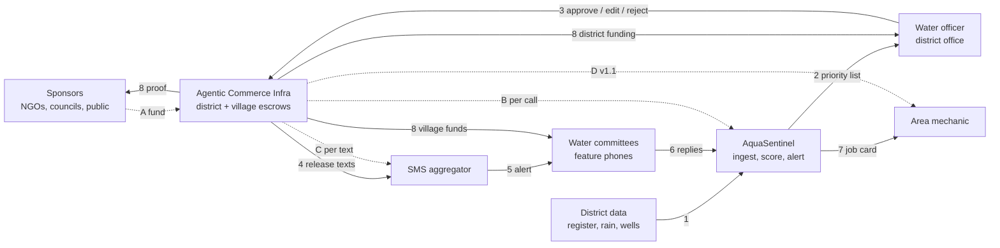

# Aqua Sentinel Solution Architecture

**DISCUSSION DRAFT** · Not final. For Team Ocean review. 17 Oct 2026.

## How it works on the ground

**Sponsors** (NGOs, councils, companies and members of the public) put money into the **Agentic Commerce Infra** whenever they choose (A). Each sponsor picks where it goes: the district escrow, which supports every village, or one village's own escrow. The money stays in escrow until the work is done. Each week, **AquaSentinel** reads the **District data** (1) and gives every water point a score. It sends the **Water officer** a priority list showing which water points need attention and why (2). Nothing goes out until the officer approves, edits or rejects that list (3). Each time AquaSentinel does its work, the Agentic Commerce Infra pays it a small fee from the escrow (B).

Once the officer approves, the Agentic Commerce Infra releases the texts to the **SMS aggregator** (4). It pays the aggregator for each text delivered (C), and the aggregator sends one short message to each of the **Water committees** (5). Committees text back, for example "BROKEN" or "OK" (6), which feeds next week's score. When a repair is needed, AquaSentinel sends the job to the **Area mechanic** (7). In v1.1, the mechanic will be paid from the escrow once the repair is confirmed (D). At every step, the Agentic Commerce Infra sends verified proof in real time (8). Sponsors see their own contribution and exactly where it went. The Water officer sees the funding state for the whole district. Each village's Water committee sees proof of its own funds.

## The flow

Solid arrows carry data and proof (numbered); dashed arrows carry money (lettered).

## Every flow

| # | From → to | What moves |
| --- | --- | --- |
| 1 | District data → AquaSentinel | Water-point register, repair records, rainfall, well levels |
| 2 | AquaSentinel → Water officer | Weekly priority list, with why each water point scored the way it did |
| 3 | Water officer → Agentic Commerce Infra | Approve, edit or reject the list |
| 4 | Agentic Commerce Infra → SMS aggregator | Approved texts released to send |
| 5 | SMS aggregator → Water committees | One text per committee (Swahili first in the field; English in the demo) |
| 6 | Water committees → AquaSentinel | Reply texts like "BROKEN" or "OK" |
| 7 | AquaSentinel → Area mechanic | Repair job, sent only after approval |
| 8 | Agentic Commerce Infra → Sponsors | Verified proof of each sponsor's contribution and where it went |
| 8 | Agentic Commerce Infra → Water officer | Funding state for the whole district |
| 8 | Agentic Commerce Infra → Water committees | Verified proof of their own village's funds |
| A | Sponsors → Agentic Commerce Infra | Funds in real time, to the district escrow or one village's escrow |
| B | Agentic Commerce Infra → AquaSentinel | Small fee for each tool call (about $0.001) |
| C | Agentic Commerce Infra → SMS aggregator | About $0.02 for each text delivered (case pack range $0.01–0.03) |
| D | Agentic Commerce Infra → Area mechanic | Payment when a repair is confirmed (v1.1, not live yet) |

## Live on Qatom today (17 Oct 2026)

| Step | Qatom item | Transaction |
| --- | --- | --- |
| A: $1 sponsorship of KJ-WP-0631 Olagoni | 212, AquaSentinel: sponsor a Kijana water point | 91ca3e13-86db-49fd-a584-ee507eb9f8de |
| 3–4: officer-approved alert for Olagoni, $0.02 | 213, AquaSentinel: send an approved water alert | 9d919d86-a347-4e0b-8d26-7fb395bbca91 |

**DISCUSSION DRAFT** · Not final. For Team Ocean review.
